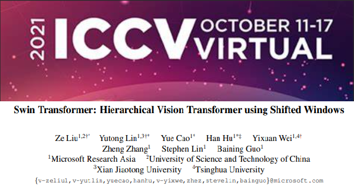
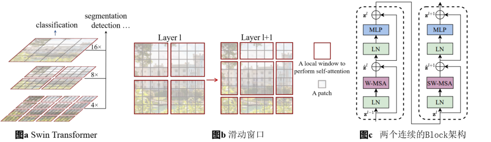
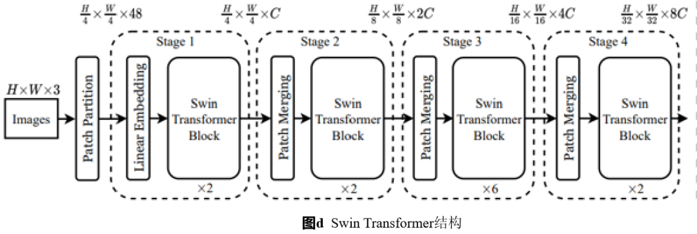
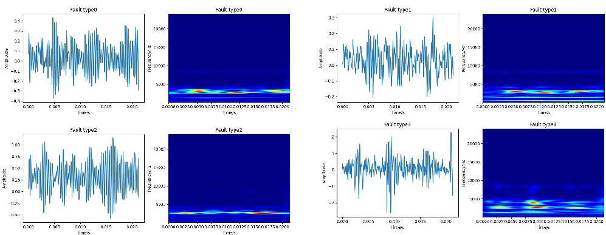
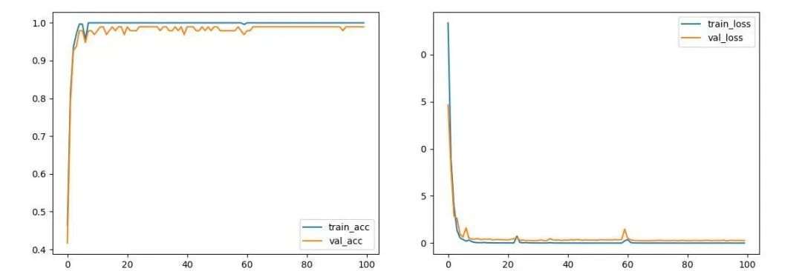
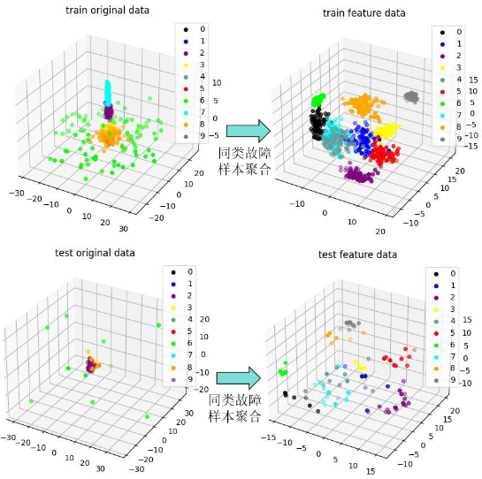

# Top-level conference model! SwinTransformer and wavelet time-frequency graph for bearing fault diagnosis with PyTorch code, run directly!

Applicable Platform: Python
Bearing Fault Diagnosis Based on SwinTransformer and Wavelet Time-Frequency Image - PyTorch Code
Model Explanation: The Swin-Transformer proposed by the Microsoft Research Institute was published in the International Conference on Computer Vision (ICCV), which is one of the three major conferences in computer vision. It has demonstrated outstanding performance in computer vision tasks, especially in image classification, object detection, and segmentation, proving the widespread application value of the Transformer in visual tasks. The concept of video patches was also present in the recently popular Sora model from OpenAI, undeniably, Swin Transformer played a significant role in introducing the patch concept.
Swin comes from Shifted Windows, which is also a main innovation point of Swin Transformer. Swin Transformer achieves the same level of feature extraction as convolutional neural networks by breaking down into several blocks, allowing for multi-scale features.
In simple terms, Swin Transformer adopts a clever approach to processing large images by dividing them into many small pieces and processing each piece separately before combining them, thus enabling more efficient handling of large images.
It first uses the patch partition to divide the input image into non-overlapping patches. Then it employs linear embedding to project the patches onto dimension C, followed by alternating use of window attention mechanisms and shifted window attention, and employs patch merging for downsampling operations (acting like a pooling layer in CNN).
This paper combines the Swin Transformer with wavelet time-frequency graphs for bearing fault diagnosis, and has not yet been published.

The innovative aspects of the model:
1. One-dimensional feature imageization: Unlike traditional fault diagnosis methods that use one-dimensional time-series feature extraction techniques such as mean variance, HHT envelope spectrum, FFT spectrum, and wavelet energy spectrum, the wavelet time-frequency graph transforms one-dimensional signals into two-dimensional images. It provides various different frequency and resolution feature representations, which can better reflect the dynamic characteristics of signals and changes in frequency components.
2. Local-global attention mechanism: Traditional CNN models usually perform convolution operations on the entire image through fixed-size filters in the convolution layer. The Swin Transformer introduces a local-global attention mechanism called Window Attention. It divides the image into small pieces and uses self-attention mechanisms to focus on different scales, allowing the model to more effectively capture both local and global information in the image, thereby improving the performance of image classification or fault recognition.
3. Long-range dependency modeling: Due to the introduction of self-attention mechanisms by the Swin Transformer, it can better model the long-range dependencies between different regions in the image. This allows the model to better understand the connections between different parts of the image, thus making classification or identification more accurate.
4. Parameter efficiency: Compared to traditional CNN and Transformer models, the Swin Transformer has better parameter efficiency. Traditional Transformers are based on global computation for attention, resulting in very high computational complexity. In contrast, the Swin Transformer limits the calculation of attention to each window, thereby reducing the computational load.
Adapting to Large-Scale Images: Traditional CNN models often face performance degradation when processing large-scale images. However, the Swin Transformer overcomes this by segmenting the image into smaller pieces and using self-attention mechanisms to focus on different scales of the image, enabling the model to better adapt to the processing of large-scale images.
Strong Generalization Ability: The Swin Transformer introduces self-attention mechanisms and local-global attention mechanisms, allowing the model to better understand the content in the image and possess stronger generalization capabilities. This results in good performance across various datasets and tasks.
Introduction to Bearing Fault Diagnosis Program Based on SwinTransformer and Wavelet Time-Frequency Imagery:
①Data Introduction:
Using the bearing fault diagnosis dataset from Xi'an Jiaotong University, with 48K/0HP data, comprising 10 types of faults, each sample is divided into 1024 points after sampling, with 100 samples per fault type, totaling 1000 samples. Then, a 7:2:1 division is made for training set, validation set, and test set.
②One-Dimensional Time Series to Wavelet Time-Frequency Imagery:
③Model Training and Validation Curves:
The test set is input into the trained model, achieving 99% test accuracy.
④Test Results and Feature Visualization Analysis:
Original sample distribution is chaotic and unordered.
After model training, intra-class samples are aggregated, and inter-class samples are separated.

## Images

<!-- PAYMENT_BLOCK -->

## Get this dataset

- Payment link (Stripe): [Buy now](https://buy.stripe.com/3cs8yP7sY87d0vu9AB)
- Payment QR code: 

<!-- /PAYMENT_BLOCK -->
